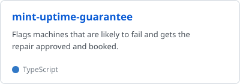
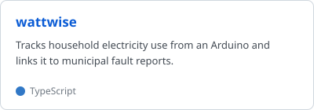
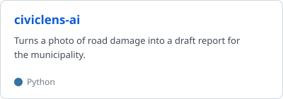
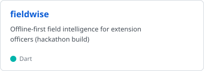

  

<h2 align="center">Hey, my name's Kea</h2>

  

  
  
  

  I'm a 2nd year Computer Science &amp; Informatics student at UNISA, building backends on the side. 
  Most of my projects come out of hackathons. Here are the ones I'm proudest of.

  <a href="https://github.com/Kea-nhlapo/mint-uptime-guarantee"><picture><source media="(prefers-color-scheme: dark)" srcset="assets/cards/mint-uptime-guarantee-dark.svg"></picture></a>
  <a href="https://github.com/wattwiseg13/wattwise"><picture><source media="(prefers-color-scheme: dark)" srcset="assets/cards/wattwise-dark.svg"></picture></a>
  <a href="https://github.com/Kea-nhlapo/civiclens-ai"><picture><source media="(prefers-color-scheme: dark)" srcset="assets/cards/civiclens-ai-dark.svg"></picture></a>
  <a href="https://github.com/Kea-nhlapo/fieldwise"><picture><source media="(prefers-color-scheme: dark)" srcset="assets/cards/fieldwise-dark.svg"></picture></a>

<b>Recently pushed</b>

 

<!-- recent_repos starts -->
- [thinta](https://github.com/Kea-nhlapo/thinta) 2026-11-13 Thinta + Fika: an agent team that makes maths graphs accessible to blind and Deaf learners (SA Educate)
- [Kea-nhlapo.github.io](https://github.com/Kea-nhlapo/Kea-nhlapo.github.io) 2026-11-12
- [learnbridge-asl](https://github.com/Kea-nhlapo/learnbridge-asl) 2026-11-11 LearnBridge: accessible learning prototype with transcripts and experimental ASL signing
- [tamp-ice-backend-mvp](https://github.com/Kea-nhlapo/tamp-ice-backend-mvp) 2026-11-04
- [granite-field](https://github.com/Kea-nhlapo/granite-field) 2026-11-04
- [fieldwise](https://github.com/Kea-nhlapo/fieldwise) 2026-10-17 Offline-first field intelligence for extension officers (hackathon build)
<!-- recent_repos ends -->

<b>What I work with</b>

 

**Languages** 

**Backend & data** 

**Cloud & delivery** 

<b>Stats</b>

 

  <picture>
    <source media="(prefers-color-scheme: dark)" srcset="https://streak-stats.demolab.com/?user=Kea-nhlapo&theme=github-dark-blue&hide_border=true&border_radius=8">
    
  </picture>

  

